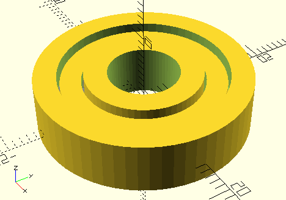
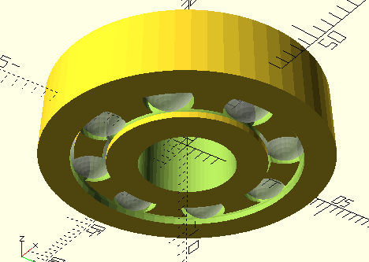
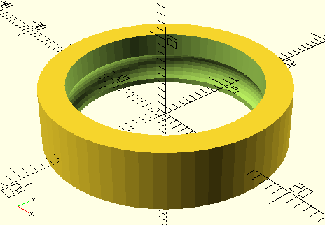
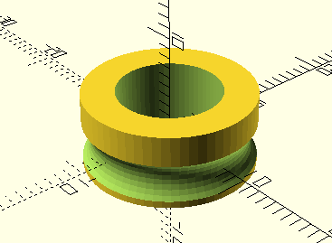
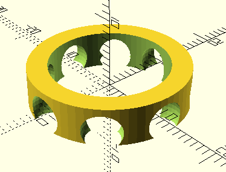

# Ball Bearing

This is a [Conrad style](https://en.wikipedia.org/wiki/Ball_bearing#Construction_types) ball bearing design.

## Parts
There's three parts, the outer race, the inner race, and the cage.

## Parameters

The parameters of the design are in [constants.scad](constants.scad).

The rules of the game are:
* The bottom of the races must be aligned with the bottom of the steel balls. Otherwise it's annoying to get the balls into the track.
* The top of the cage needs to be above the top of the balls so that it's a continuous piece (cage_top_extension)
* The bottom of the cage needs to be high enough to leave open a large enough gap to pop the balls in (cage_bottom_subtraction)
* The gap between the two races must be large enough to insert the balls (race_bore_offset)
* The cage and races should be close enough, or the cage will wobble around as it spins (race_cage_clearance)
* Its nice to have the top of the races above the top of the cage (race_top_extension)

## Build

The task file uses the openscad CLI to generate an STL file for each part.